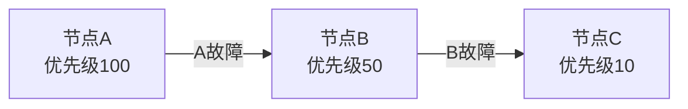
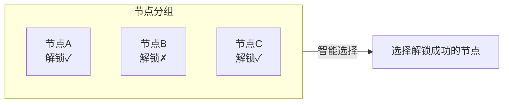
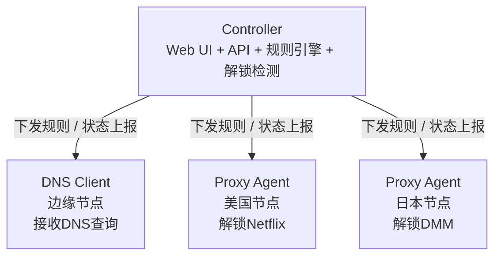

# chenfei Glass Prism DNS

新增节点出现“任务失败 · 已返回项目 0”时，见 [v1.5.30 修复与升级说明](CHANGELOG_v1.5.30.md)：本版统一面板生成命令与发布版本，并补齐检测 Worker 和首次任务恢复。

这是 [xcxcadc/chenfei-Glass-Prism-dns](https://github.com/xcxcadc/chenfei-Glass-Prism-dns) 的中文增强版本。默认提供简体中文界面、自定义服务域名与分类、服务级解锁机切换、IP 配置闭环、解锁链路流量统计、账户安全和客户端脚本。当前面板增强层与发布脚本版本为 `1.5.30`，SNI 传输版本为 `2.5.2`；完整说明见 [ENHANCED_ZH.md](ENHANCED_ZH.md)，增强层版本见 [Releases](https://github.com/xcxcadc/chenfei-Glass-Prism-dns/releases)。

Prism-Gateway 是一个基于 DNS 的分流规则管理面板。轻量，非侵入式部署，支持流媒体解锁和 AI 服务智能解锁检测。采用 Liquid Glass 风格 UI。

[English](README_EN.md) | 中文

## 🌐 项目说明

上游在线演示 [prism.ciii.club](https://prism.ciii.club) 仅用于了解原始 Controller；本 Fork 的中文增强功能需按下方命令部署。

## 💬 加入讨论

**Telegram 群组**: [https://t.me/Prism_Gateway](https://t.me/Prism_Gateway)

## 功能特性

### 核心功能

- **智能 DNS 路由** - 根据域名规则将流量路由到不同 Proxy Agent
- **外部规则集支持** - 支持导入外部规则集文件，快速配置常用服务
- **流媒体解锁检测** - 完整显示官方脚本菜单 `0` 的 IPv4 跨国平台结果，包括 Netflix、Disney+；未覆盖的服务明确标注，不冒充已验证
- **AI 服务解锁检测** - 原样显示官方脚本的 ChatGPT、Claude、Google Gemini 结果及限制信息；不等同于账号登录或付费功能已验证
- **双栈节点管理** - 面板仍可管理 IPv4/IPv6 节点；受管 DNS 解锁链路固定使用 Proxy IPv4，egress 不会自动切到 IPv6，并抑制已选服务的 AAAA，避免误走不解锁的 IPv6
- **实时监控** - 基于 SSE 的节点状态实时更新
- **现代控制台** - 表格化服务编排与概览卡片，提供服务编排、节点管理、IP 配置、域名同步、日志审计、告警和设置七个真实功能页，支持桌面/移动端、深浅主题和中英文切换
- **简体中文增强界面** - 默认中文，可切换英文和深浅主题
- **细化服务域名库** - 运行时动态解析 `stream.smartdns.list` 的最新有效服务；已停止运营的 Crackle、Salto、GYAO 不再参与路由
- **服务域名与删除管理** - 任意内置或自定义服务都可在前端编辑域名、增删域名并恢复域名库默认值；服务操作栏和配置弹窗提供彻底删除，删除会移除规则、目标 IP 路由、实测结果，并持久化隐藏内置服务，后续同步不会自动恢复
- **多类型分流规则** - 服务规则编辑器同时支持域名后缀、域名关键词和 IPv4/IPv6 `IP-CIDR`；规则列表与 Agent 同步会保留 `DOMAIN-SUFFIX`、`DOMAIN-KEYWORD`、`IP-CIDR` 类型。内置 Grok 已加入 xAI/Twitter 域名、`twitter` 关键词及上游六段 CIDR 规则
- **统一服务搜索** - 服务库和 IP 服务选择器均支持名称、中文别名、分类、服务 ID 与域名的精确或模糊搜索，忽略大小写及常见分隔符
- **分类自由编排** - 可新建自定义分类，把内置或自定义服务移动到任意分类并随时恢复原分类；分类调整不改变服务 ID、域名或已下发路由
- **服务级手动路由** - 每个受管目标 IP 的每项服务显式绑定到任意解锁机；只有保存配置才会改变出口，受管路由不跟随 Smart/Fallback 或检测结果自动跳转
- **稳定 Agent 数据面** - 安装器默认使用并锁定上游 `v1.2.1` 兼容 Agent，避免 `v1.3` 被动熔断在 WAF、拒绝连接或批量实测时把固定解锁 VIP 回退为公网 DNS
- **共享域名联动** - 使用相同父域、子域或泛域名的服务自动绑定同一解锁机；最后一次选择优先，避免一条 DNS 规则被两个出口互相覆盖
- **实测不改路由** - 目标机审计只更新结果，绝不会依据 WAF、超时或第三方检测波动自动切换解锁机；节点选择始终以用户最后一次保存为准
- **5 秒授权白名单** - Proxy 每 5 秒从面板同步已纳管目标 IPv4，只允许白名单访问 IPv4 DNS 53 与 SNI 80/443，只拒绝 IPv6 DNS 53，不拦截 IPv6 80/443；同机 MTProxy 等 IPv6 业务可继续使用
- **官方脚本实时检测** - 每台 Proxy/Client 默认安装独立 `prism-media-check` worker；仅运行官方脚本的 IPv4 跨国平台项目，按官方 label 原样展示 `Yes`、`No`、地区和 WAF
- **媒体与路由分离** - 官方脚本结果是媒体结论，DNS/TLS/SNI 和页面探测独立保留为路由诊断，不再覆盖或改写媒体结果；不保证付费播放或账号登录成功
- **IP 配置闭环** - 添加目标 IP，批量选择服务及对应解锁机，自动创建 DNS 节点和服务覆盖
- **配置自动生效** - 增强层持久化逐节点路由并由专用 dnsmasq 应用；10 秒守卫检查配置哈希、DNS 监听和代理进程 DNS 接管，保存后安全刷新本地 IPv4 路由，300 秒抽测每项服务代表域名
- **代理 DNS 统一接管** - 对 XrayR、V2bX、sing-box、Hysteria、TUIC 等活动 systemd 代理进程建立独立 DNS cgroup 规则，将请求交给本机 Prism Agent；不会读取、修改或重启 XrayR、V2bX、Docker、MTProxy 或其他业务配置
- **受限网络传输** - 目标机可通过加密 TCP SNI 传输连接解锁机；客户端每 60 秒同步并用真实 HTTPS 路径检查隧道，SSH 自身仍以 15 秒保活、3 次失联判定，发现“TCP 假在线”时只重建该隧道
- **可恢复检测任务** - 有输出即逐批上报，界面每秒刷新；任务进度和历史持久化，关窗重开可继续读取，旧四阶段检测不再作为最终媒体结论
- **共存守护** - 仅监控并恢复 Prism 自有服务，不会重启或覆盖 XrayR、V2bX、MTProxy、Docker 等业务
- **服务品牌图标** - 服务卡片和 IP 选择器立即显示本地占位并异步替换为对应品牌图标；图标 URL 带版本指纹，发布后不会继续命中旧缓存，服务与图标映射持久化后可直接复用
- **客户端管理脚本** - 安装 DNS Agent、测试本机 DNS、接管/备份/恢复系统 DNS
- **流量统计** - 每个目标 IP 独立统计本机 Prism DNS 的 UDP/TCP 53，以及到所选解锁机的 TCP 80/443；不统计整机网卡流量

- **业务隔离** - Prism 只维护自己的 DNS、nftables、dnsmasq、Agent 和传输服务，不会改动 XrayR、V2bX、MTProxy、Docker 或其他业务配置
- **账户安全** - 点击右上角用户名，验证旧账号后修改管理员用户名和密码

### 路由模式

本项目支持灵活的节点分组和路由策略：

#### Group (节点分组)

将多个 Proxy Agent 组成一个分组，每个节点可设置优先级（数值越大优先级越高）。分组内支持两种选择策略：

| 组内策略 | 说明 |
|----------|------|
| **Smart** | 智能选择 - 在组内自动选择解锁状态最佳的节点 |
| **Fallback** | 故障转移 - 按组内优先级从高到低尝试，当前节点失败时自动切换到下一个 |

#### 优先级规则

优先级按数值从大到小排序：

```
优先级 100 (最高) → 优先级 50 → 优先级 10 → 优先级 1 (最低)
```

#### 工作原理

**Fallback 模式**：按优先级从高到低依次尝试



**Smart 模式**：自动选择解锁状态最佳的节点



**示例场景**：
- **Fallback 模式**：优先级 100 > 50 > 10，优先使用最高优先级节点，故障时依次降级
- **Smart 模式**：自动检测组内所有节点的解锁状态，选择解锁成功的节点

### 解锁检测

官方脚本菜单 `0` 当前覆盖以下平台与地区信息：

“节点管理”和“IP 配置”的媒体检测由对应 Proxy/Client 上的独立 worker 执行。安装路径为 `/usr/local/bin/prism-media-check`，由 `prism-media-check.timer` / `prism-media-check.service` 每 5 秒尝试 claim 待处理任务，独立于 transport 同步和每分钟流量上报。worker 下载并校验官方脚本后，运行等价于 `bash check.unlock.media -M4 -R0 -Een` 的命令（`check.unlock.media` 指下载后的脚本文件）：相当于交互菜单 `0`，只测跨国平台、仅 IPv4，使用英文官方 label。

结果按官方 label 解析，原始 `Yes` / `No`、地区、WAF 等内容保持不变；脚本没有对应项目的服务显示“未覆盖”，不会伪造为可用。DNS A 映射、AAAA 抑制、TLS/SNI 和代表页面仍可独立诊断，但不再改写媒体结论；旧 full / 四阶段检测和 Agent 自检均不作为最终媒体结论。这是**官方脚本检测结果，不是实际付费播放、账号登录或所有应用功能通过的保证**。

worker 每秒检查新输出并逐批上报，界面每 1 秒刷新已收到的结果，无需等整轮结束。脚本完整运行，不设 30 秒硬截止；15 分钟仅作异常安全兜底，超限、脚本异常或无有效结果明确标记 `failed`。90 秒无心跳显示 worker 失联并标记失败，不会当成通过。关闭检测窗口不会取消后台任务，重开可读取已持久化的任务进度和历史。

媒体结果每 6 小时自动刷新，也支持手动重测及配置代更新后重测；路由、Proxy IPv4 或检测请求变化后，旧 `generation` 的迟到结果会被拒收，防止覆盖当前配置。检测只报告结果，不修改用户选择的解锁机。实现与升级说明见 [中文增强说明](ENHANCED_ZH.md)。

**流媒体服务**
- Netflix、Disney+、DAZN、Amazon Prime Video、TVBAnywhere+
- YouTube Premium、Spotify Registration、iQyi Oversea Region
- YouTube/Netflix CDN 及 Apple、Bing、Google Play、Steam 等地区信息

**AI 服务**
- OpenAI (ChatGPT)
- Anthropic (Claude)
- Google (Gemini)

HBO Max、Hulu、Copilot 等可配置域名分流，但不在菜单 `0` 覆盖范围内，不能据此宣称检测通过。

## 安装

### 命令速查

以下命令固定使用发布标签 `v1.5.30`。尖括号内容必须替换为面板实际生成的值；不要把包含令牌的专属命令公开或提交到仓库。

| 用途 | 命令 |
|------|------|
| 安装/升级面板 | `curl -fsSL https://raw.githubusercontent.com/xcxcadc/chenfei-Glass-Prism-dns/refs/tags/v1.5.30/enhanced_install.sh \| sudo bash` |
| 卸载面板但保留数据 | `curl -fsSL https://raw.githubusercontent.com/xcxcadc/chenfei-Glass-Prism-dns/refs/tags/v1.5.30/uninstall.sh \| sudo bash -s -- panel --yes` |
| 卸载面板并删除数据 | `curl -fsSL https://raw.githubusercontent.com/xcxcadc/chenfei-Glass-Prism-dns/refs/tags/v1.5.30/uninstall.sh \| sudo bash -s -- panel --purge-data --yes` |
| 安装解锁机 Agent | `curl -fsSL https://raw.githubusercontent.com/xcxcadc/chenfei-Glass-Prism-dns/refs/tags/v1.5.30/agent_install.sh \| sudo bash -s -- --master <面板地址> --secret <节点密钥>` |
| 卸载解锁机 Agent | `curl -fsSL https://raw.githubusercontent.com/xcxcadc/chenfei-Glass-Prism-dns/refs/tags/v1.5.30/uninstall.sh \| sudo bash -s -- proxy --yes` |
| 卸载被解锁机 Agent | `curl -fsSL https://raw.githubusercontent.com/xcxcadc/chenfei-Glass-Prism-dns/refs/tags/v1.5.30/uninstall.sh \| sudo bash -s -- client --yes` |
| 卸载未知类型 Agent | `curl -fsSL https://raw.githubusercontent.com/xcxcadc/chenfei-Glass-Prism-dns/refs/tags/v1.5.30/uninstall.sh \| sudo bash -s -- agent --yes` |

被解锁机首次安装请优先执行“IP 配置”页面生成的专属命令；它会同时安装 DNS Agent、runtime、透明 SNI transport、授权同步和媒体 worker。每台 Proxy/Client（包括以后新增的机器）都会随 transport 默认安装 worker，卸载 transport / Agent 时一并移除其 timer、service 和可执行文件。卸载被解锁机还会恢复原 DNS，并清理 Prism 自有规则和计数器，不会启动、停止或修改 XrayR、V2bX、MTProxy、Docker 等其他业务；完整命令见 [卸载说明](UNINSTALL_ZH.md)。

**仅替换 enhancer 二进制不会自动刷新远端节点。** 既有 Proxy 请重新执行 `v1.5.30` 的节点 Agent 安装命令；既有 Client 请重新执行本版“IP 配置”专属命令，或用本版 `prismdns.sh --refresh-runtime` 刷新已有配置的 runtime、transport `2.5.2` 和 worker。`prism_transport.sh --sync` 仅同步已安装的传输配置，不会下载升级脚本或补装 worker；具体步骤见 [中文增强说明](ENHANCED_ZH.md#已有节点升级)。

### 为什么增加透明 SNI 出口

Akile 的稳定性来自“系统 DNS 统一接管”：选中的域名返回指定解锁机 IPv4，未选中的域名保持直连。Prism 现在采用同一原则，并增加桌面兼容层：如果 XrayR、V2bX、v2node、sing-box 等受管代理进程已经把域名解析成真实 IP，目标机仍会从 TLS SNI 或 HTTP Host 识别选中的服务，并把 TCP 80/443 透明转发到该服务绑定的解锁机 IPv4；未选服务不进入透明出口。受管进程的 UDP/443 会拒绝，使客户端回落到可识别域名的 TCP/TLS，避免“手机可用、电脑加载或连接被关闭”。

这不是把所有流量强制送进解锁机：Google 等未配置服务仍走目标服务器直连。每个目标 IP 的出口映射由面板动态下发，没有写死现有节点，后续新增解锁机、目标机或服务也使用同一逻辑。版本 `1.5.30` 的目标机升级后，可用 `/usr/local/lib/prismdns/prism_transport.sh --status` 确认 `mode=direct`、`client_egress=active`；若现有目标机未升级，请重新执行“IP 配置”生成命令，避免只升级面板而旧目标机继续使用旧数据面。

transport `2.5.2` 支持在旧面板地址失效时，从运行中 Agent 的 `--master` 恢复并验证新地址后持久化；也可显式指定新 `--master`。Proxy 的 AUTH nftables 规则经校验后原子替换，不先删除整套授权规则；地址迁移步骤见 [迁移教程](MIGRATION_ZH.md)。

### 一键安装 (推荐)

```bash
curl -fsSL https://raw.githubusercontent.com/xcxcadc/chenfei-Glass-Prism-dns/refs/tags/v1.5.30/enhanced_install.sh | sudo bash
```

自定义端口：

```bash
curl -fsSL https://raw.githubusercontent.com/xcxcadc/chenfei-Glass-Prism-dns/refs/tags/v1.5.30/enhanced_install.sh \
  | sudo PRISM_PORT=8080 PRISM_CORE_PORT=18080 bash
```

脚本会安装或升级上游 Controller 和本 Fork 的中文增强层，升级前自动备份 `data.db`。

安装完成后：
- Web 界面：`http://你的IP:端口`
- 用户名：`admin`
- 密码：安装完成时显示
- Controller 数据：`/opt/prism/data.db`
- 中文增强层全部数据：`/var/lib/prism-enhancer/`

登录后可点击右上角用户名打开“账户安全”，验证当前用户名和密码后修改管理员账户。
侧栏的“站点设置”可以自定义左上角网页名称、说明文字和浏览器标签标题，设置保存在 `/var/lib/prism-enhancer/branding.json`。
服务库中的“分类管理”可新建分类；每项服务右侧的“分类”按钮可移动或恢复分类，设置保存在 `/var/lib/prism-enhancer/catalog-preferences.json`。

更换服务器前必须同时备份 Controller 数据库、环境文件和整个 Enhancer 数据目录。完整导出、恢复、验证及回滚步骤见 [面板迁移与灾备教程](MIGRATION_ZH.md)。

### 全新安装与数据脱敏

仓库只包含程序代码、安装脚本和前端资源，不包含任何运行时数据库、节点密钥、账号密码、IP 配置、流量记录或当前服务器数据。新服务器执行安装命令时会创建空白数据并生成新的 JWT 密钥和初始密码，不会复制本面板的节点或服务配置。图标可在登录后的“设置中心 → 站点设置”中上传透明 PNG，运行时文件保存在 `/var/lib/prism-enhancer/branding-icon.png`。

如需在一台曾安装过 Prism 的服务器上明确执行脱敏全新安装，请先确认该机不再需要原面板数据，然后执行：

```bash
curl -fsSL https://raw.githubusercontent.com/xcxcadc/chenfei-Glass-Prism-dns/refs/tags/v1.5.30/enhanced_install.sh \\
  | sudo env PRISM_FRESH_INSTALL=1 PRISM_CONFIRM_FRESH=YES bash
```

该模式只清理 Prism 的 `/opt/prism/data.db`、`/opt/prism/.env`、初始密码文件和 `/var/lib/prism-enhancer/`，不会删除或修改 Docker、XrayR、V2bX、MTProxy 等其他业务。迁移旧面板必须按 [面板迁移与灾备教程](MIGRATION_ZH.md) 显式恢复，安装脚本不会自动带入旧数据。

### 手动安装

Controller/Agent 二进制由[上游 Releases](https://github.com/mslxi/Liquid-Glass-Prism-dns/releases) 提供；中文增强层由[本 Fork Releases](https://github.com/xcxcadc/chenfei-Glass-Prism-dns/releases) 提供。通常建议直接使用上面的一键安装命令。

```bash
# 下载
wget https://github.com/mslxi/Liquid-Glass-Prism-dns/releases/latest/download/prism-controller-linux-amd64
chmod +x prism-controller-linux-amd64
mkdir -p /opt/prism
mv prism-controller-linux-amd64 /opt/prism/prism-controller

# 创建环境文件
echo "JWT_SECRET=$(openssl rand -hex 16)" > /opt/prism/.env

# 运行
cd /opt/prism && ./prism-controller --host 0.0.0.0 --port 8080
```

## Agent 安装

在节点服务器上安装 Agent：

```bash
curl -sL https://raw.githubusercontent.com/xcxcadc/chenfei-Glass-Prism-dns/refs/tags/v1.5.30/agent_install.sh | bash -s -- --master <Controller地址> --secret <节点密钥>
```

### IP 客户端一键工具

先在 Web 界面的“IP 配置”中添加目标 IP、选择服务与解锁机并保存。页面会生成包含面板地址和配置令牌的专属命令。也可以先启动通用交互工具：

```bash
wget -qO- https://raw.githubusercontent.com/xcxcadc/chenfei-Glass-Prism-dns/refs/tags/v1.5.30/prismdns.sh | sudo bash
```

页面生成的专属命令用于首次安装及已有节点升级；日常新增、取消或切换服务只需在面板保存，路由会自动生效，不必反复安装。通用工具支持安装/连接 DNS Client Agent、本机 DNS 测试、系统 DNS 接管、备份和恢复。稳定通道默认校验并锁定上游兼容 Agent `v1.2.1`，它不是本 Fork 的 `1.5.30` 发布版本，也不是上游 `v1.3`。

安装器备份并停用冲突的旧 `dnsmasq`/`sniproxy`，安装监听 `127.0.0.1:5353` 的专用 dnsmasq，按面板配置生成精确 IPv4 与 AAAA 抑制规则，并用 nftables 接管本机 53 请求。每 10 秒检查配置和 DNS 监听，每 300 秒抽测各服务代表域名；配置变化和 30 分钟路由健康缓存刷新仍全量校验域名。路由更新优先原子替换规则并重启专用 DNS，Agent 仅在健康恢复失败时兜底重启。安装只阻塞于 DNS 映射错误，不等待整轮媒体检测。

transport 默认直连已授权 Proxy IPv4，受限网络可显式选择加密 TCP SNI 模式；已选出口的 UDP/443 被拒绝以促使应用回落到 TCP/TLS。每分钟任务只负责流量上报，媒体检测由独立 worker 执行，二者不会串行阻塞。清零面板流量保留采样基线，避免旧流量重新入账。

以上路由守卫、IPv4 优先、AAAA 抑制、独立路由诊断、授权白名单、流量统计、媒体 worker 和自动应用逻辑均从面板数据动态生成，不包含固定 IP，可直接用于后续新增的任意解锁机和被解锁机。实测结果不会触发节点跳转；如需更换线路，必须在面板手动选择并保存。

IP 配置、节点密钥、专属令牌和流量基线保存在 `/var/lib/prism-enhancer/ip-configs.json`（`0600`）。目标机另外将 DNS 与每个 SNI 解锁方向的 nftables 原始计数持久化到 `/var/lib/prismdns/traffic-cumulative.json`，单个计数器重建或审计清零不会让历史流量丢失；重新绑定新配置时按令牌隔离统计状态。不要公开页面生成的专属命令或令牌。完整操作步骤和统计口径见 [中文增强说明](ENHANCED_ZH.md)。

### Agent 参数说明

| 参数 | 说明 | 适用节点 |
|------|------|----------|
| `--master` | Controller 的地址，例如 `http://192.168.1.1:8080` | 所有节点 |
| `--secret` | 在 Controller 中创建节点时生成的密钥 | 所有节点 |
| `--smart` | 启用智能解锁检测模式 | 仅 DNS Client |
| `--beta` | 使用 Beta 版本 | 所有节点 |

## 架构



| 组件 | 描述 |
|------|------|
| **Controller** | 中央控制器，提供 Web UI、API、规则引擎和解锁检测 |
| **DNS Client** | 边缘节点，接收 DNS 查询，根据规则转发到对应 Proxy Agent |
| **Proxy Agent** | 出口节点，转发流量到目标服务器，上报解锁状态。支持嵌套解锁：若 VPS 商家提供 DNS 解锁服务，该 VPS 可作为 Proxy Agent 为其他 DNS Client 提供代理 |

## 使用流程

1. **安装 Controller** - 在中央服务器上安装
2. **创建节点** - 在 Web UI 中创建 DNS Client 和 Proxy Agent 节点
3. **安装 Agent** - 在各节点服务器上安装 Agent
4. **配置规则** - 创建 DNS 规则，选择路由模式和目标节点
5. **开始使用** - 将客户端 DNS 指向 DNS Client 节点

## 服务管理

```bash
# 查看状态
sudo systemctl status prism-controller

# 重启服务
sudo systemctl restart prism-controller

# 查看日志
journalctl -u prism-controller -f
```

## 迁移与备份

面板迁移不能只复制 `data.db`。节点中文名称与地区、自定义服务及分类、IP 路由、流量、品牌设置和 SNI 传输授权信息保存在 `/var/lib/prism-enhancer/`；媒体任务进度和历史保存在同一 `dataDir` 下的 `media-checks.json`，必须随整个目录备份与恢复。

请按 [面板迁移与灾备教程](MIGRATION_ZH.md) 操作，教程包含：

- 旧服务器停机一致性备份与 SHA256 校验
- 新服务器安装、恢复和权限修复
- 节点、服务、IP 配置、流量和品牌设置验证
- 域名或端口变化时的 Agent 重新接入
- 恢复失败后的回滚流程

## 📸 截图预览


